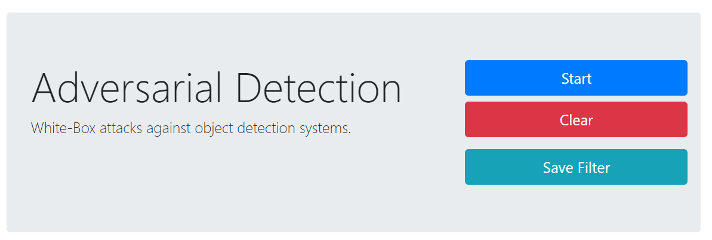
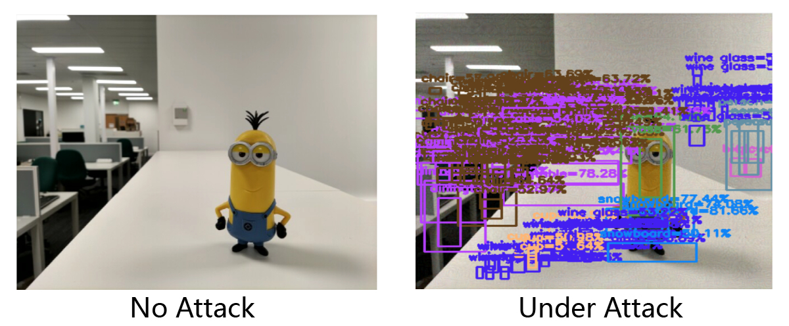

# Step 1: Generating the Perturbation

We first need to generate an image-agnostic Universal Adversarial Perturbation (UAP).

## Quick Start

You may use [anaconda](https://www.continuum.io/downloads) or [miniconda](https://conda.io/miniconda.html). 

```
# Clone the repo
$ git clone https://github.com/wuhanstudio/adversarial-camera/
$ cd adversarial-camera/detection

# For CPU
$ conda env create -f environment.yml
$ conda activate adversarial-camera

# For GPU
$ conda env create -f environment_gpu.yml
$ conda activate adversarial-gpu-camera

$ python detect.py --model model/yolov3-tiny.h5 --class_name coco_classes.txt
```

The web page will be available at: http://localhost:9090/

That's it! The perturbation is saved as `noise.npy` file in the `detection/noise/` folder.




## White-box Adversarial Toolbox

Alternatively, you can generate the UAP using the [WHite-box Adversarial Toolbox (WHAT)](https://github.com/wuhanstudio/whitebox-adversarial-toolbox).


<br />

# Step 2: Deploying the Perturbation

You can use a raspberry pi 4 to deploy the perturbation ([documentation](../hardware/README.md)).
